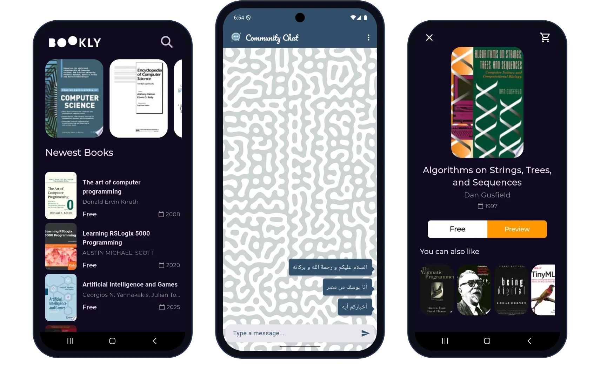

<picture>
  <source media="(prefers-color-scheme: dark)" srcset="assets/banner-dark.svg" />
  <source media="(prefers-color-scheme: light)" srcset="assets/banner-light.svg" />
  
</picture>

<p align="center">
  <a href="https://linkedin.com/in/YoussefShawky0"></a>
  <a href="https://x.com/YoussefShawky0"></a>
</p>

## About me

```dart
class YoussefShawky extends Developer {
  final role = 'CS Student & Flutter Developer';
  final stack = ['Flutter', 'Dart', 'Firebase', 'Supabase', 'BLoC'];
  final currentlyBuilding = 'Guess Party — a multiplayer party game';
  final openTo = ['Internships', 'Freelance', 'Collaboration'];
}
```

## What I build

<p align="center">
  
</p>

<table>
  <tr>
    <td width="50%" valign="top">
      <h3>🎭 <a href="https://github.com/YoussefShawky0/guess_party">Guess Party</a></h3>
      A multiplayer social-deduction party game with an online mode and a pass-and-play mode on a single device.
      <br /><br />
      <code>Flutter</code> <code>Supabase</code> <code>BLoC</code>
    </td>
    <td width="50%" valign="top">
      <h3>🚗 <a href="https://github.com/YoussefShawky0/bariq">Bariq</a></h3>
      On-demand mobile car care: request car-care services straight from your phone.
      <br /><br />
      <code>Flutter</code> <code>Supabase</code> <code>BLoC</code>
    </td>
  </tr>
  <tr>
    <td width="50%" valign="top">
      <h3>📚 <a href="https://github.com/YoussefShawky0/BookVerse">BookVerse</a></h3>
      Discover and preview books through the Google Books API, with shimmer loading and real-time search.
      <br /><br />
      <code>Flutter</code> <code>Dio</code> <code>BLoC</code>
    </td>
    <td width="50%" valign="top">
      <h3>💬 <a href="https://github.com/YoussefShawky0/community_chat_app">Community Chat</a></h3>
      A real-time group chat app with email sign-up, login and live messages.
      <br /><br />
      <code>Flutter</code> <code>Firebase Auth</code> <code>Firestore</code>
    </td>
  </tr>
</table>

## Tech stack

<p align="center">
  
</p>

<br />

<picture>
  <source media="(prefers-color-scheme: dark)" srcset="https://raw.githubusercontent.com/YoussefShawky0/YoussefShawky0/output/snake-dark.svg" />
  <source media="(prefers-color-scheme: light)" srcset="https://raw.githubusercontent.com/YoussefShawky0/YoussefShawky0/output/snake.svg" />
  
</picture>
